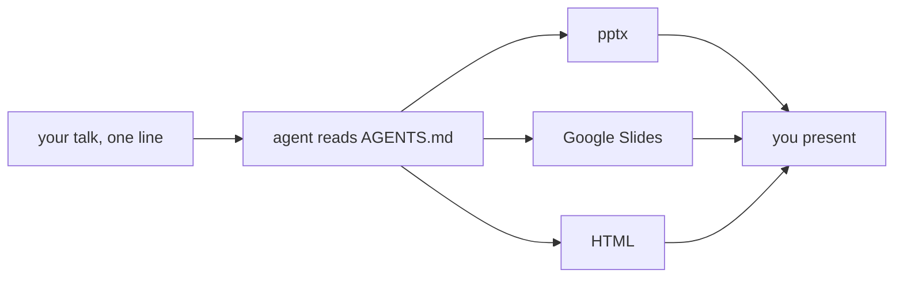
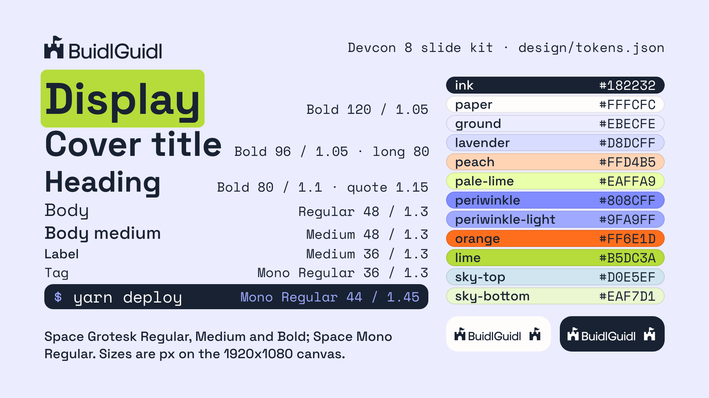

# BuidlGuidl slide kit for Devcon 8

BuidlGuidl runs a day of community talks at Devcon 8 in Mumbai. This kit gives every speaker the same slide design, so all the decks match. It has design tokens, fonts, backgrounds with the BuidlGuidl logos, eleven layouts, a reference deck, a pptx template and a Google Slides master. Build in whatever format you present from.


## Give this to your agent

Paste one line into Claude Code, Codex, Claude chat, or whatever builds your slides:

```
Clone https://github.com/technophile-04/devcon-8-mumbai and follow its AGENTS.md to build my slides for <talk title>.
```

Add your name, your handle and the format you want. If you don't name a format, the agent picks one. It builds the deck from the kit's layouts and checks every slide against the rules before it hands the deck back.



## What stays the same


Every deck uses the same backgrounds, logos, fonts, colours, type sizes and margins, and the same title and closing slides. On the title slide you change the talk title, your name and your handle.

## Design tokens and fonts

Every colour, font, size and radius is a token in [design/tokens.json](design/tokens.json). The file uses the W3C Design Tokens format, so Figma's Tokens Studio and Style Dictionary can read it.

<a href="https://technophile-04.github.io/devcon-8-mumbai/design/style-sheet.html"></a>

The card shows the colours, the type sizes and the logos. The [full style sheet](https://technophile-04.github.io/devcon-8-mumbai/design/style-sheet.html) also shows what each token is for, the margins and the highlight.

The fonts are Space Grotesk and Space Mono, free under the SIL Open Font License. [fonts/](fonts/) has the files and the steps to install them.

## Content slides

| | |
| --- | --- |
|  |  |
|  |  |

Everything between the title and closing slides is up to you, in any order. Use at most one lime highlight per slide. There are eight content layouts: statement, heading and body, heading and image, three columns, section divider, code, quote and diagram. The [reference deck](https://technophile-04.github.io/devcon-8-mumbai/reference/deck.html) shows each one.

## Formats

| You present from | Build | On the presenting laptop |
| --- | --- | --- |
| PowerPoint or Keynote | pptx, [recipe](recipes/pptx.md) | install the two fonts from [fonts/](fonts/) |
| Google Slides, your own or the Devcon link | the pptx saved as Google Slides, or a copy of the master, [recipe](recipes/google-slides.md) | nothing, Google Slides has the fonts |
| a browser on your own laptop | HTML, [recipe](recipes/html.md) | internet for Google Fonts, or link `fonts/fonts.css` to work offline |

Any other tool, like Reveal.js, Slidev or Figma, works too. Use the tokens in [design/tokens.json](design/tokens.json) and the backgrounds and positions in [AGENTS.md](AGENTS.md), and match the renders in `reference/slides/`.

## Build by hand

Make a copy of the [Google Slides master](https://docs.google.com/presentation/d/136xTO2H0B167bFT280bk2gp4YB4F5S2wskYhJqDga1U/copy), or open `template/buidlguidl-devcon8.pptx`. Both have one layout per slide type and an example slide for each. Duplicate the example you want, replace the text and delete the rest.

## Devcon rules

Devcon's [speaker guidelines](https://ef-events.notion.site/Devcon-8-India-Speaker-Guidelines-3e3638cdc41580e2abd8de93aeb659be) add these rules. AGENTS.md has the details under Devcon rules.

- Sessions are recorded and streamed to YouTube.
- Body text is 24 pt or larger.
- No QR codes or links to crypto products that aren't compliant with Indian law.
- Don't call digital assets "currency", "securities", "custodian" or "depositories".

Final slides are due Oct 27.

## Regenerating the kit

This section is for maintainers. To change the look, edit `design/tokens.json` and run `build/build.sh`. It regenerates:

- `design/tokens.css`, which the reference deck loads
- the logo PNGs and the "Devcon 8" tag
- the backgrounds
- the slide renders and the contact sheet
- the style sheet and the overview card, as pages and PNGs
- the pptx

Layout positions are not tokens. They are written in `AGENTS.md`, `reference/deck.html` and `build/build_pptx.py`, so a position change touches all three.

The build needs Google Chrome, Python 3 with Pillow, `uv` to fetch python-pptx, and a network connection for Google Fonts. The source art in `build/src/` comes from the buidlguidl.com repo. The castle mark in `logos/` is cut from the wordmark. After a rebuild, upload the new pptx to Google Drive and replace the master.
