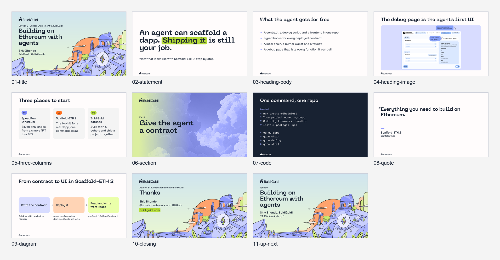
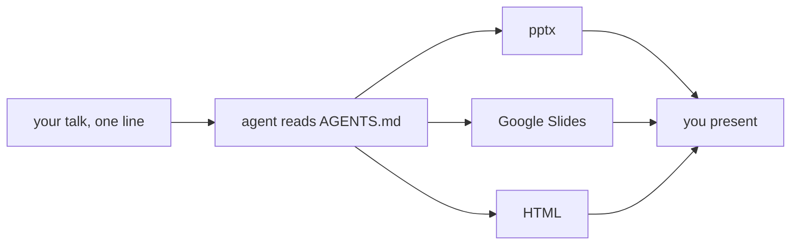
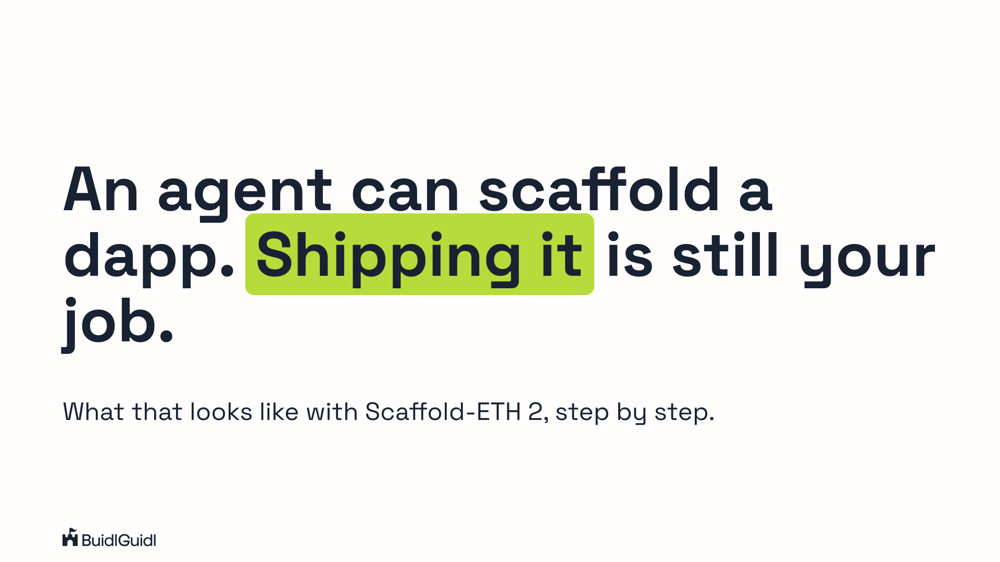
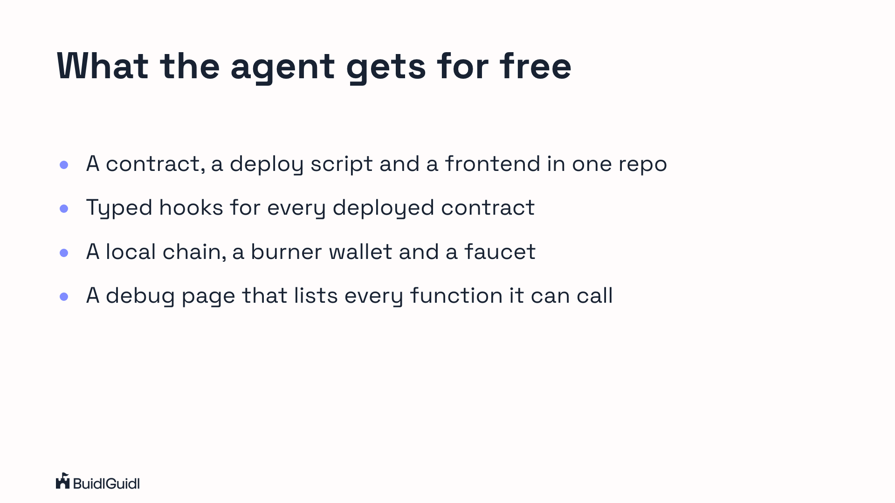
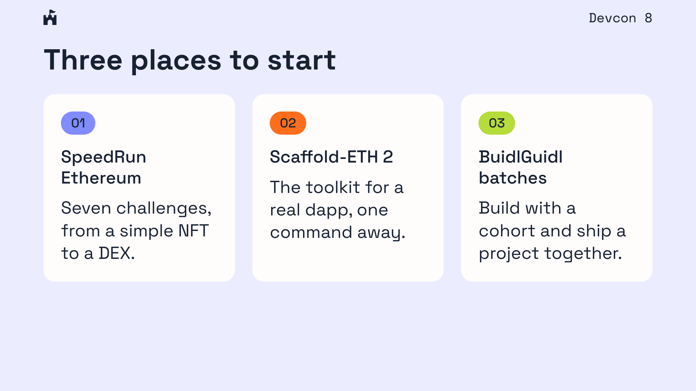
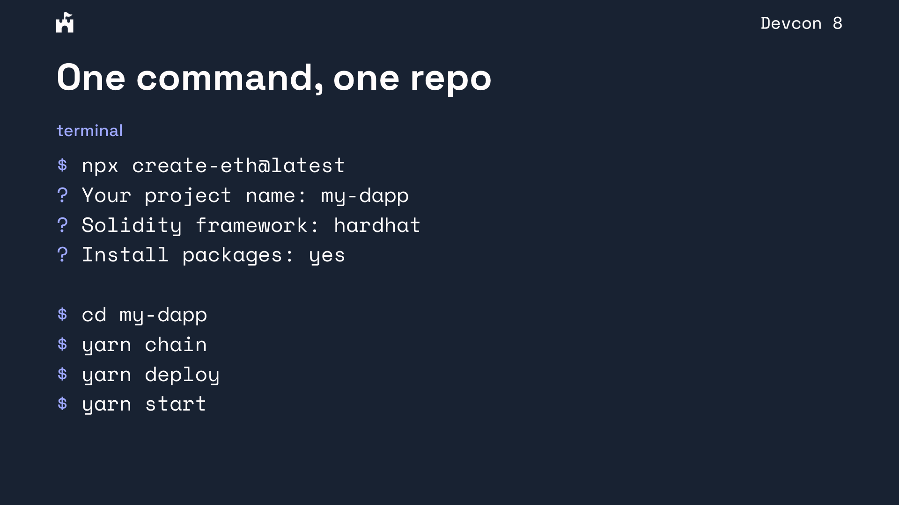

# BuidlGuidl slide kit for Devcon 8

BuidlGuidl runs a day of community talks at Devcon 8 in Mumbai. Every speaker builds their own slides, and this kit makes all of them look like one family: four backgrounds with the BuidlGuidl marks already in place, the colours, fonts and sizes, eleven layouts, a reference deck, and a pptx template. Build in whatever format you present from.

**The frame is locked. The content is yours.**



## Give this to your agent

Paste one line into Claude Code, Codex, Claude chat, or whatever builds your slides:

```
Clone https://github.com/technophile-04/devcon-8-mumbai and follow its AGENTS.md to build my slides for <talk title>.
```

Add your name, your handle and the format you want, if you have one. The agent picks a format otherwise, builds the deck in the kit's layouts, and checks every slide against the rules before handing it back.



## The frame


Locked: the backgrounds and the marks baked into them, the fonts, the colours, the type scale, the margins, and the title and closing slides. On the title slide you change three things: the talk title, your name and your handle.

## The content

| | |
| --- | --- |
|  |  |
|  |  |

Yours: everything between title and closing, in any order, with at most one lime highlight per slide. The eight content layouts are statement, heading and body, heading and image, three columns, section divider, code, quote and diagram. Every layout is live at https://technophile-04.github.io/devcon-8-mumbai/reference/deck.html.

## Formats

| You present from | Build | On the presenting laptop |
| --- | --- | --- |
| PowerPoint or Keynote | pptx, [recipe](recipes/pptx.md) | install Space Grotesk and Space Mono from fonts.google.com |
| Google Slides, your own or the Devcon link | the pptx saved as Google Slides, or a copy of the master, [recipe](recipes/google-slides.md) | nothing, the fonts are built in |
| a browser on your own laptop | HTML, [recipe](recipes/html.md) | internet for Google Fonts, or the two fonts installed |

Another tool, like Reveal.js, Slidev or Figma, uses the same colours, fonts, backgrounds and positions, all listed in [AGENTS.md](AGENTS.md). Match the renders in `reference/slides/`.

## Build by hand

Copy the Google Slides master (https://docs.google.com/presentation/d/136xTO2H0B167bFT280bk2gp4YB4F5S2wskYhJqDga1U/copy opens the copy dialog), or open `template/buidlguidl-devcon8.pptx`. Both hold one layout per slide type and an example slide of each. Duplicate the example you want, replace the text, delete the rest.

## Devcon rules

Sessions are recorded, body text is 24 pt or larger, QR codes to non-compliant crypto products are out, and a few words are off limits. The full list is under Devcon rules in [AGENTS.md](AGENTS.md). Devcon wants final slides by Oct 27; the guidelines are at https://ef-events.notion.site/Devcon-8-India-Speaker-Guidelines-3e3638cdc41580e2abd8de93aeb659be.

## Regenerating the kit

For maintainers. `build/build.sh` rebuilds the logo PNGs, the "Devcon 8" tag, the backgrounds, the slide renders, the contact sheet and the pptx. The reference PNGs are rendered from `reference/deck.html`. It needs Google Chrome, Python 3 with Pillow, `uv` (which fetches python-pptx), and network for Google Fonts. The source art in `build/src/` comes from the buidlguidl.com repo; the castle mark in `logos/` is cut from the wordmark. After a rebuild, upload the new pptx to Google Drive and replace the master.
